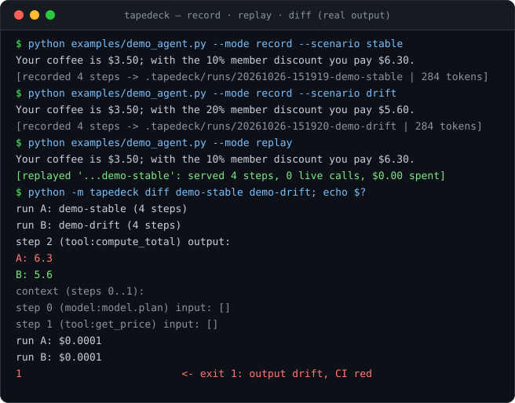
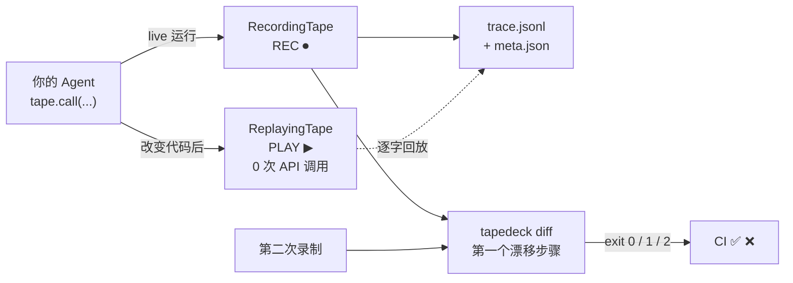
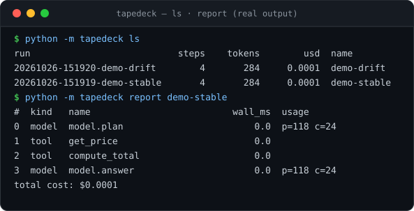

# tapedeck

[](https://github.com/EAnge1o/tapedeck/actions/workflows/ci.yml)
[](https://python.org/)
[]()
[](LICENSE)

**tapedeck** 是给 LLM Agent 用的**飞行记录仪**：录一次（REC ⏺），永久离线重放（PLAY ▶），精确 diff 出第一个漂移的步骤（⏩）。

> 每个做过 Agent 的人都遇到同一个夜晚：**昨天还好好的 agent，今天改了一行 prompt 就坏了。** 重跑一次要花钱，重跑十次才复现，日志里只有一坨 print。tapedeck 把整次运行（每次模型调用、每次工具调用、每份 usage）录成带版本号的 JSONL；之后重放零 API 成本、逐字节确定；两个 run 之间一条命令 diff，直接告诉你**第几步、哪个调用、从什么值变成了什么值**。

零依赖：纯 Python 标准库（连测试都是 `unittest`）。不上传任何数据——trace 就是本地文件，可以进 git、可以 cat、可以 rsync。



*（截图由 `docs/make_demo_svg.py` 用真实命令输出渲染而成，不是摆拍。）*

## 它如何工作



## 30 秒上手

```bash
pip install -e .                      # 或者直接把 tapedeck/ 放进你的项目
python examples/demo_agent.py --mode record --scenario stable
python examples/demo_agent.py --mode record --scenario drift   # 有人改了折扣策略
python examples/demo_agent.py --mode replay                    # 离线重放，$0.00
python -m tapedeck diff demo-stable demo-drift
```

真实输出（以上命令原样粘贴，非手写示例）：

```
=== replay ===
Your coffee is $3.50; with the 10% member discount you pay $6.30.

[replayed '20261026-151919-demo-stable': served 4 steps, 0 live calls, $0.00 spent]

=== diff demo-stable demo-drift ===
run A: demo-stable (4 steps)
run B: demo-drift (4 steps)
step 2 (tool:compute_total) output:
  A: 6.3
  B: 5.6
  context (steps 0..1):
    step 0 (model:model.plan) input: []
    step 1 (tool:get_price) input: []
run A: $0.0001
run B: $0.0001
```

diff 的退出码为 CI 而设计：`0` 完全一致，`1` 输出漂移，`2` 结构漂移（步骤增删）。

## 为什么不是 LangSmith / LangFuse

| | 云端可观测平台 | **tapedeck** |
|---|---|---|
| 定位 | 看运行（dashboard） | **复现运行（记录仪）** |
| 重放 | 重新调用 LLM（花钱、不确定） | **回放录制的输出（免费、确定）** |
| 回归测试 | 不适用 | `replay` + `diff --fail-on-drift` 进 CI |
| 数据 | 上传到第三方 | **只在本机，纯文件** |
| 集成 | SDK + 上报配置 | 两个函数调用，零依赖 |

两者是互补而非替代：平台上看趋势，tapedeck 里做取证。当你需要回答"这次事故的完整调用序列是什么、它和上周五那次差在哪"，本地文件比网页快照可靠得多。

## 三行接入

Agent 代码只面向一个接口：`tape.call(kind, name, fn, *args)`——live 录制时执行 `fn` 并记档，重放时**直接回放录制值、根本不调用 `fn`**（所以不花钱、不会失败）。

```python
import tapedeck

def run_agent(tape, message):                      # 接收 tape，而不是自己调 openai
    reply = tape.call("model", "deepseek.chat", chat, messages)   # fn = 你的真实调用
    return tape.call("tool", "postprocess", lambda: reply.strip())

with tapedeck.record("chat-v3", redact=tapedeck.Redactor()) as tape:   # REC：退出自动存盘
    run_agent(tape, "hello")

with tapedeck.play("chat-v3") as tape:                                 # PLAY：免费回归测试
    run_agent(tape, "hello")                                           # 退出时自动校验步数
```

接入原则：**model 调用和有副作用的工具调用经过 tape，纯函数不经过。** usage 跟着 model 调用一起记档（provider 返回什么就存什么），成本按你自己维护的价格表换算。

## CLI

```text
tapedeck ls                  # 所有 run：步数 / tokens / 成本（最新在前）
tapedeck report RUN          # 单个 run 的逐步明细表
tapedeck diff A B            # 第一个漂移点 + 上下文 + usage/成本对照
tapedeck prune --keep 20     # 只留最近 20 个 run
```



## 录制格式

每个 run 一个目录，两个纯文件（`DESIGN.md` 有完整 schema）：

```
.tapedeck/runs/20261026-151919-demo-stable/
    meta.json     # 名称、时间、主机、步数、是否脱敏
    trace.jsonl   # 每行一个步骤：kind/name/input/output/error/usage/wall_ms
```

```json
{"v": 1, "i": 0, "kind": "model", "name": "model.plan",
 "input": [], "output": {"tool": "get_price", "args": "coffee"},
 "usage": {"prompt_tokens": 118, "completion_tokens": 24, "model": "deepseek-chat"},
 "wall_ms": 0.142}
```

## 诚实边界

- **闭包里的变化检测不到。** replay 按调用点的输入做匹配；如果漂移藏在闭包捕获的变量里（不经过参数），输入匹配不会报警——这正是 `diff`（两次真实录制的对比）存在的意义，也是 README 建议"有副作用的调用把关键参数显式传参"的原因。
- **确定性重放只到 I/O 层。** 若 agent 内部有未播种的随机数或读时钟，重放结果可能不同于录制——这是所有 record/replay 方案（VCR.py、respx）的共同边界。
- **没有自动 monkeypatch。** OpenAI/DeepSeek 客户端的自动拦截需要 per-SDK 适配器，v0.1 选择显式 `tape.call`（3 行侵入）换取零依赖与零魔法。见 Roadmap。

## Roadmap

- [ ] OpenAI / DeepSeek SDK 自动拦截适配器（可选安装）
- [ ] `tapedeck replay` 的 lenient 模式 CLI 化（从第一个漂移点切回 live 继续跑）
- [ ] trace 签名（防篡改哈希链）
- [ ] 与 pytest 集成的 fixture

## 设计取舍

见 [DESIGN.md](DESIGN.md)：为什么 trace 是 JSONL 而不是 SQLite、为什么按位置对齐而不是按内容对齐、为什么脱敏默认关闭而重放默认严格。

## 同系列

[nimbus-infer](https://github.com/EAnge1o/nimbus-infer) · [nimbus-infer-rs](https://github.com/EAnge1o/nimbus-infer-rs) · [nimbus-vm](https://github.com/EAnge1o/nimbus-vm) · [nimbus-kv](https://github.com/EAnge1o/nimbus-kv) —— tapedeck 是系列里第一个面向**产品与工作流**的工具：同样零依赖，但交付的不是引擎，是一条更顺的工作流。

姊妹项目 [mocktape](https://github.com/EAnge1o/mocktape)：把同样的"录制一次、离线重放"思想用在 **HTTP 层**——把真实 API 录成可读的 YAML cassette，供前端/集成测试离线回放，404 时给出最近磁带匹配的诊断。mocktape 管 HTTP 流量，tapedeck 管 agent 决策，互相不知道对方存在，但常常一起出现在同一个测试套件里。

## License

MIT
