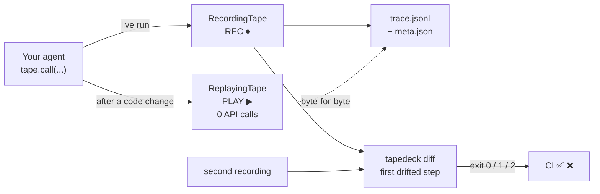

# tapedeck


[](https://github.com/EAnge1o/tapedeck/actions/workflows/ci.yml)
[](https://pypi.org/project/tapedeck-llm/)
[](https://python.org/)
[]()
[](LICENSE)

**tapedeck** is a **flight recorder** for LLM agents: record a run once (REC ⏺), replay it offline forever (PLAY ▶), and diff exactly where behavior drifted (⏩).

> Everyone who has shipped an agent knows the same night: **the agent worked yesterday, you changed one line of prompt today, and now it's broken.** Rerunning costs money, ten reruns still don't reproduce it, and the logs are a wall of prints. tapedeck records the whole run — every model call, every tool call, every usage block — as versioned JSONL. From then on, replay costs $0.00 and is byte-for-byte deterministic, and one command diffs two runs to tell you **which step, which call, which value changed**.

Zero dependencies: pure Python standard library (even the tests are `unittest`). Nothing is uploaded anywhere — a trace is a local file you can commit, `cat`, and `rsync`.


*(The screenshot is rendered from real command output by `docs/make_demo_svg.py` — not staged.)*

中文文档：[README.zh-CN.md](README.zh-CN.md)

## How it works



## 30 seconds

```bash
pip install tapedeck-llm              # or drop the tapedeck/ folder into your project
python examples/demo_agent.py --mode record --scenario stable
python examples/demo_agent.py --mode record --scenario drift   # someone changed the discount policy
python examples/demo_agent.py --mode replay                    # offline replay, $0.00
python -m tapedeck diff demo-stable demo-drift
```

Real output (paste the commands above and you get this verbatim):

```
=== replay ===
Your coffee is $3.50; with the 10% member discount you pay $6.30.

[replayed '20261026-151919-demo-stable': served 4 steps, 0 live calls, $0.00 spent]

=== diff demo-stable demo-drift ===
run A: demo-stable (4 steps)
run B: demo-drift (4 steps)
step 2 (tool:compute_total) output:
  A: 6.3
  B: 5.6
  context (steps 0..1):
    step 0 (model:model.plan) input: []
    step 1 (tool:get_price) input: []
run A: $0.0001
run B: $0.0001
```

`diff` exit codes are designed for CI: `0` identical, `1` output drift, `2` structural drift (steps added or removed).

## Watch your SDK client (no code changes)

Refactoring every call into `tape.call` is honest but invasive. If your agent talks to a provider SDK directly, hand the client to the tape instead — the code keeps reading like plain SDK calls:

```python
import tapedeck, openai

client = openai.OpenAI()                    # DeepSeek/vLLM/Ollama: same client, your base_url
with tapedeck.record("chat-v3") as tape:
    client = tape.watch(client)             # REC ⏺ -- traced live
    resp = client.chat.completions.create(model="deepseek-chat", messages=msgs)

with tapedeck.play("chat-v3") as tape:
    client = tape.watch(client)             # PLAY ▶ -- served from tape, no network
    resp = client.chat.completions.create(model="deepseek-chat", messages=msgs)
```

Intercepted method paths: `chat.completions.create` (the OpenAI SDK, which covers every OpenAI-compatible endpoint — **DeepSeek, vLLM, Ollama** — via `base_url`), `responses.create` (OpenAI Responses API), and `messages.create` (Anthropic), including `stream=True` (recorded chunk by chunk, replayed chunk by chunk). Install per provider: `pip install "tapedeck-llm[openai]"` / `"tapedeck-llm[anthropic]"`. The SDK is imported only here; the core stays dependency-free.

Replay rebuilds the SDK's own response objects from the trace (`model_validate`), so `resp.choices[0].message.content` and `resp.usage.prompt_tokens` work exactly as before. If the installed SDK has drifted from the recording, replay degrades to an attribute shim instead of crashing — content access survives, and strict input matching still flags the request drift.

## In pytest

```python
def test_agent_replies(tape):                 # pip install "tapedeck-llm[pytest]"
    reply = my_agent(tape, "what's the price?")
    assert "3.50" in reply
```

Every test that asks for `tape` leaves a trace under `.tapedeck/runs/` (saved even if the test fails — crashes are data). `tapedeck ls` lists them, `tapedeck diff` compares two of them.

## In CI — the regression test

Record once locally, commit the trace (or cache it as an artifact), then make replay a pull-request check:

```yaml
# .github/workflows/agent-regression.yml
steps:
  - uses: actions/checkout@v4
  - uses: actions/setup-python@v5
    with: { python-version: "3.12" }
  - run: pip install tapedeck-llm
  - run: python my_agent.py --replay demo-stable     # your code, tape.play inside
  - run: |
      python -m tapedeck replay demo-stable
      python -m tapedeck diff demo-stable demo-drift --fail-on-drift  # or assert the exit code
```

`replay` serves recorded outputs — the job spends $0.00 and never touches the network. A diff that drifts fails the check and prints the first diverging step.

## Why not LangSmith / LangFuse

| | Cloud observability platforms | **tapedeck** |
|---|---|---|
| Position | look at runs (dashboard) | **reproduce runs (recorder)** |
| Replay | re-calls the LLM (costly, nondeterministic) | **replays recorded outputs (free, deterministic)** |
| Regression tests | not applicable | `replay` + `diff` exit codes in CI |
| Data | uploaded to a third party | **local files only** |
| Integration | SDK + reporting config | two function calls, zero dependencies |

The two are complementary, not competing: platforms show trends, tapedeck does forensics. When the question is "what was the exact call sequence of that incident, and how does it differ from last Friday's run", a local file beats a web snapshot.

## Three lines to integrate

Agent code faces one interface: `tape.call(kind, name, fn, *args)` — when recording, it executes `fn` and files the result; when replaying, it **returns the recorded value and never calls `fn`** (so replays cost nothing and cannot fail).

```python
import tapedeck

def run_agent(tape, message):                      # take a tape instead of calling openai yourself
    reply = tape.call("model", "deepseek.chat", chat, messages)   # fn = your real call
    return tape.call("tool", "postprocess", lambda: reply.strip())

with tapedeck.record("chat-v3", redact=tapedeck.Redactor()) as tape:   # REC: saved on exit
    run_agent(tape, "hello")

with tapedeck.play("chat-v3") as tape:                                 # PLAY: free regression test
    run_agent(tape, "hello")                                           # step count verified on exit
```

Integration principle: **model calls and side-effectful tool calls go through the tape; pure functions don't.** Usage is recorded with each model call (whatever the provider returned), and cost is converted through a price table you own.

## CLI

```text
tapedeck ls                  # all runs: steps / tokens / cost (newest first)
tapedeck report RUN          # per-step table for one run
tapedeck diff A B            # first drift + context + usage/cost comparison
tapedeck prune --keep 20     # keep only the 20 newest runs
```


## Trace format

One directory per run, two plain files (`DESIGN.md` has the full schema):

```
.tapedeck/runs/20261026-151919-demo-stable/
    meta.json     # name, time, host, step count, redaction flag
    trace.jsonl   # one step per line: kind/name/input/output/error/usage/wall_ms
```

```json
{"v": 1, "i": 0, "kind": "model", "name": "model.plan",
 "input": [], "output": {"tool": "get_price", "args": "coffee"},
 "usage": {"prompt_tokens": 118, "completion_tokens": 24, "model": "deepseek-chat"},
 "wall_ms": 0.142}
```

## Honest boundaries

- **Drift captured in closures is invisible.** Replay matches call sites by their inputs; if drift hides in a variable captured by a closure (never passing through parameters), input matching won't flag it — that is exactly what `diff` between two real recordings is for, and why the README suggests passing side-effectful parameters explicitly.
- **Deterministic replay holds only up to the I/O layer.** If the agent has unseeded randomness or reads the clock internally, replay may diverge from the recording — the shared boundary of every record/replay tool (VCR.py, respx).
- **SDK interception has limits.** Requests must be JSON-able (messages, tools, sampling params are; pydantic classes and binary payloads are not — those record as `repr` and replay as an input-mismatch drift, which is the honest signal). Streaming calls land on tape only after the stream is consumed. And if the installed SDK no longer validates a recording, replay serves an attribute shim — response-shape access works, `isinstance` checks don't.
- **No monkeypatching behind your back.** `tape.watch(client)` is explicit, scoped, and returns a proxy — the original client is never mutated.

## Roadmap

- [x] OpenAI / DeepSeek / Anthropic auto-interception (`tape.watch`, optional extras)
- [x] pytest fixture (`tapedeck-llm[pytest]`)
- [ ] `tapedeck replay` lenient mode on the CLI (resume live from the first drift)
- [ ] trace signing (tamper-evident hash chain)

## Design trade-offs

See [DESIGN.md](DESIGN.md): why traces are JSONL instead of SQLite, why steps are aligned by position instead of content, why redaction defaults off while replay defaults strict.

## The tape suite

The same "record once, replay forever" idea, at three layers of an agent stack:

- **[tapedeck](https://github.com/EAnge1o/tapedeck)** (this repo) — model & tool calls *inside* your agent (Python, PyPI)
- **[mcptape](https://github.com/EAnge1o/mcptape)** — the MCP tool-protocol boundary: wrap any MCP server, replay it offline, diff what drifted (Python, PyPI)
- **[mocktape](https://github.com/EAnge1o/mocktape)** — HTTP traffic behind your frontend (TypeScript, npm)

Same-series from-scratch engines: [nimbus-infer](https://github.com/EAnge1o/nimbus-infer) · [nimbus-infer-rs](https://github.com/EAnge1o/nimbus-infer-rs) · [nimbus-vm](https://github.com/EAnge1o/nimbus-vm) · [nimbus-kv](https://github.com/EAnge1o/nimbus-kv).
